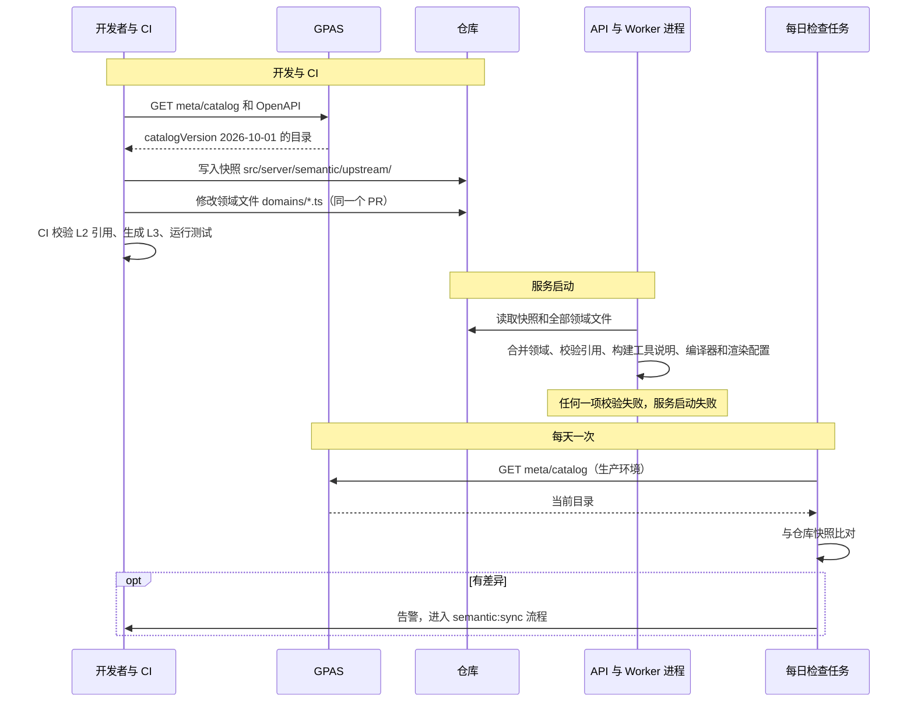
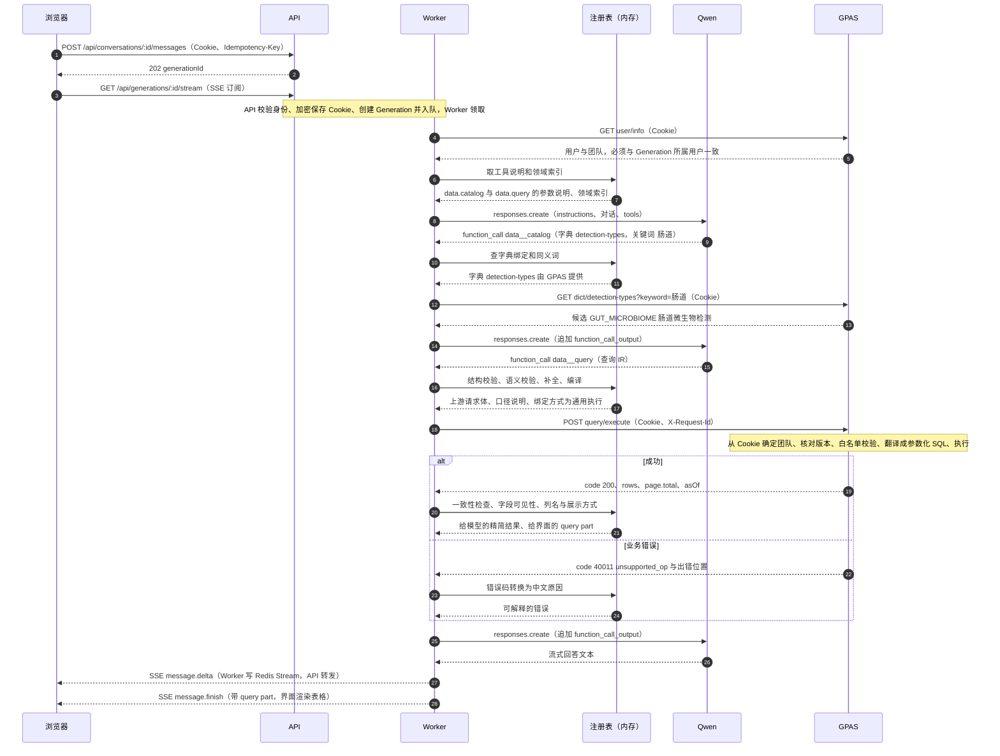
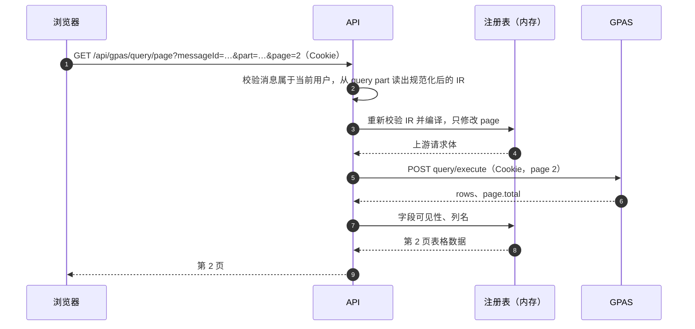
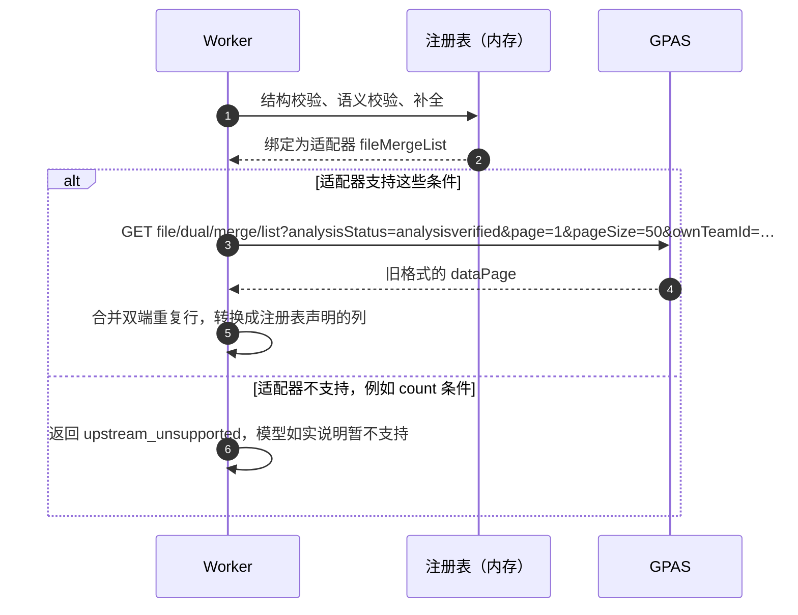
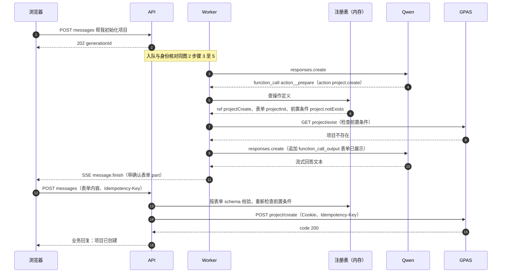

# 注册表运行时时序

> **当前方案**：GPAS 查询接入以《[GPAS 查询接入方案](gpas-query.md)》为准。本文保留为长期参考。

本文用时序图说明语义注册表在整个流程中如何运转：什么时候读注册表，各方之间发送和回复什么报文。
注册表的格式见《[GPAS 接口语义注册表规划](gpas-semantic-platform.md)》§3，
查询格式和上游接口见《[跨样本数据查询](sample-query-data-agent.md)》§5.3、§6。

图中的参与者：

| 参与者 | 是什么 |
|---|---|
| 浏览器 | 用户的聊天页面，带 GPAS 登录 Cookie |
| API | 本项目的 Fastify API 进程：入口、SSE、翻页和业务路由 |
| Worker | 本项目的 Worker 进程：执行智能体循环和工具 |
| 注册表 | 进程内存中的注册表（启动时从仓库加载，**运行时不向上游拉取**） |
| Qwen | 模型服务（Responses API） |
| GPAS | 上游业务系统 |

---

## 1. 注册表什么时候被读取

| 时机 | 谁读 | 读什么 | 是否访问 GPAS |
|---|---|---|---|
| 开发与 CI | 开发者、CI | 上游数据目录和 OpenAPI，写成仓库里的快照 | 是（`npm run semantic:sync`） |
| 服务启动 | API、Worker | 仓库中的快照和全部领域文件，构建 L3 | 否 |
| 每次请求 | API、Worker | 内存中的注册表：工具说明、校验、编译、展示 | 否（只有业务请求访问 GPAS） |
| 每天一次 | 漂移检查任务 | 生产环境的数据目录，与快照比对 | 是 |

### 1.1 注册表的生命周期

---

## 2. 一次数据查询的完整时序

例子：用户问“帮我找出鉴定到三个以上五星病原的肠道样本”。

### 2.1 各步报文

编号与图中一致。省略了与本例无关的字段。

| 步骤 | 方向 | 报文 |
|---|---|---|
| 1 | 浏览器 → API | `POST /ai-chatbot/api/conversations/:id/messages`，请求头 `Cookie`、`Idempotency-Key: <uuid>`，请求体 `{ "content": "帮我找出鉴定到三个以上五星病原的肠道样本" }` |
| 2 | API → 浏览器 | `202 { "generationId": "…" }`。消息入口是持久任务，API 重启后继续执行 |
| 3 | 浏览器 → API | `GET /ai-chatbot/api/generations/:id/stream`，SSE；断线后用 `Last-Event-ID` 续传 |
| 4–5 | Worker ↔ GPAS | `GET user/info`，带本次请求加密保存的 Cookie。返回的用户和团队必须与 Generation 一致，否则工具报错 |
| 6–7 | Worker ↔ 注册表 | 内存查表，没有网络请求。得到由注册表生成的 `data.catalog`、`data.query` 参数说明，以及“项目、样本、分析结果……”的领域索引 |
| 8 | Worker → Qwen | `responses.create({ instructions, input, tools: [user__profile, data__catalog, data__query, action__prepare] })` |
| 9 | Qwen → Worker | `function_call data__catalog`，参数 `{ "dict": "detection-types", "keyword": "肠道" }` |
| 10–11 | Worker ↔ 注册表 | 确认 `detection-types` 是登记过的字典；先用 L2 同义词匹配（“肠道”可能直接命中），没有命中再问上游 |
| 12 | Worker → GPAS | `GET dict/detection-types?keyword=肠道&limit=10`，带 Cookie。字典不含团队数据，可以按 `catalogVersion` 缓存 |
| 13 | GPAS → Worker | `{ "code": 200, "message": "ok", "data": { "items": [{ "code": "GUT_MICROBIOME", "name": "肠道微生物检测" }] } }` |
| 14 | Worker → Qwen | 追加 `function_call_output`：`{ "candidates": [{ "code": "GUT_MICROBIOME", "label": "肠道微生物检测" }] }`。多个候选时，模型应请用户选择 |
| 15 | Qwen → Worker | `function_call data__query`，参数是只用 L2 名称的 IR：`{ "entity": "sample", "where": { "and": [ { "field": "detectionType", "op": "in", "value": ["GUT_MICROBIOME"] }, { "count": "detection", "where": { "segment": "fiveStarPathogen" }, "distinct": "taxon", "cmp": { "op": "gte", "value": 3 } } ] }, "page": 1, "pageSize": 20 }` |
| 16–17 | Worker ↔ 注册表 | ① zod 结构校验 ② 字段、运算符、字典值校验 ③ 展开 `fiveStarPathogen` 为 `hazardLevel = 5`，按 `requiresParent` 加上“已鉴定”，补 `defaultSelect` 和计数列 ④ 成本检查 ⑤ 按 `ref` 把 `hazardLevel` 换成 `hazardIndex`、`taxon` 换成 `taxId` ⑥ 生成口径说明 ⑦ 查到 `binding` 为通用执行 |
| 18 | Worker → GPAS | `POST query/execute`，请求头 `Cookie`、`X-Request-Id: <generationId>-<callId>`，请求体为编译后的 IR 加 `catalogVersion`，**不含团队**（完整示例见跨样本查询方案 §6.2） |
| 19 | GPAS → Worker | `{ "code": 200, "message": "ok", "data": { "catalogVersion": "…", "asOf": "…", "columns": […], "rows": […], "page": { "page": 1, "pageSize": 20, "total": 37 } } }` |
| 20–21 | Worker ↔ 注册表 | 检查行数不超过 `pageSize`、抽查 `fiveStarCount ≥ 3`；按敏感级别过滤字段（`analysisId` 是 `internal`，只保留用于“查看详情”）；按 L2 取中文列名和 `view: sampleTable`。写一条 `ToolRun` 审计 |
| 22 | GPAS → Worker | 出错时：`{ "code": 40011, "message": "unsupported_op", "data": { "path": "where.and[1].count" } }` |
| 23–24 | Worker ↔ 注册表 | 把错误码转换成中文原因，例如“暂不支持按检出物种数量筛选”，交给模型如实说明 |
| 25 | Worker → Qwen | 追加 `function_call_output`：`{ "total": 37, "criteria": "检测项目为肠道微生物检测、已完成分析的样本中，危害等级 5 级的物种数 ≥ 3", "asOf": "…", "rows": [最多 20 行精简数据] }` |
| 26 | Qwen → Worker | 流式回答，例如“共找到 37 个样本……（口径：……）” |
| 27 | Worker → 浏览器 | SSE `message.delta`。Worker 写入 Redis Stream，API 转发给浏览器 |
| 28 | Worker → 浏览器 | SSE `message.finish`。回复消息带 `query` part：`{ columns, rows, total, asOf, criteria, ir }`，其中 `ir` 是规范化后的查询，用于翻页和后续追问；生成结束时清除加密 Cookie |

要点：

- **注册表只在进程内存中读取**（步骤 6、10、16、20、23），不产生网络请求。
- **团队只出现在 GPAS 内部**：步骤 4–5 用来核对身份，步骤 18 的请求体里没有团队，由 GPAS 从 Cookie 确定。
- **模型只发出两种请求**（步骤 9、15），都要先经过注册表校验，才会变成发给 GPAS 的报文。

---

## 3. 翻页：不经过模型

用户在表格上点“下一页”时：

翻页时 IR 来自服务端保存的消息，而不是浏览器提交的内容；数据也不进入模型上下文。

---

## 4. 适配器分支：上游新接口上线前

注册表中 `binding` 为适配器时，图 2 的步骤 18–19 换成下面的流程，其余步骤不变：

旧接口需要 `ownTeamId`，由 Worker 从会话资料中取，不来自模型。上游提供 `query/execute` 后，
把领域文件里的 `binding` 改为 `{ kind: 'generic' }`，这张图就不再出现。

---

## 5. 操作类：初始化项目

写操作分两段：第一段只生成确认表单，第二段在用户确认后由 API 的业务路由执行，模型不参与第二段。

这和现在 `project.initialize` 的行为一致。区别在于：表单定义、前置条件和策略说明来自注册表，而不是写在一个专门的工具里。
